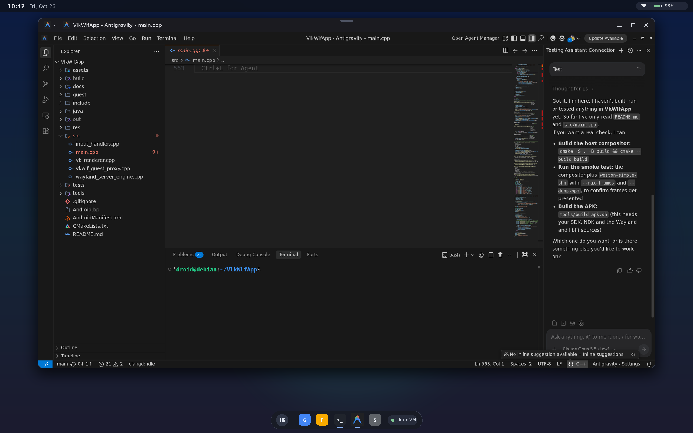
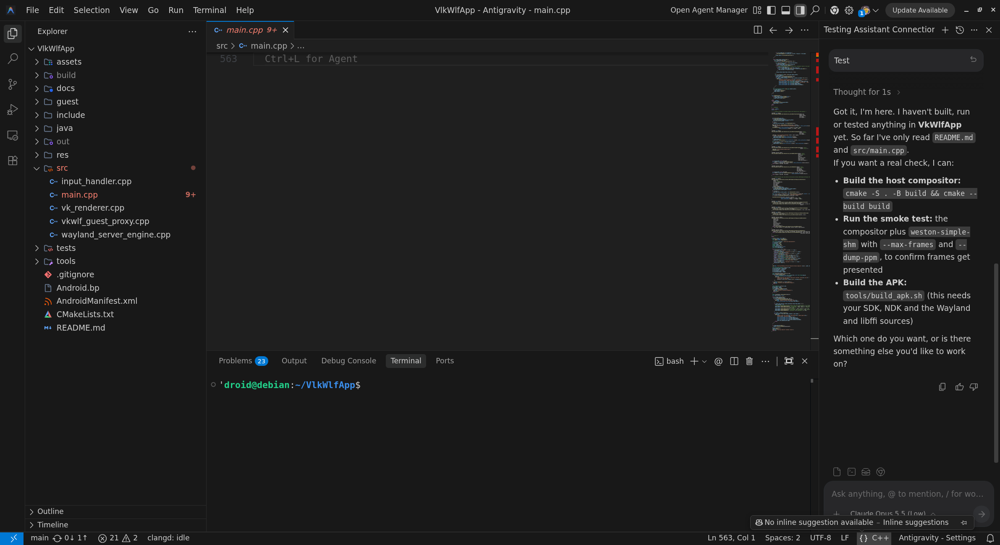
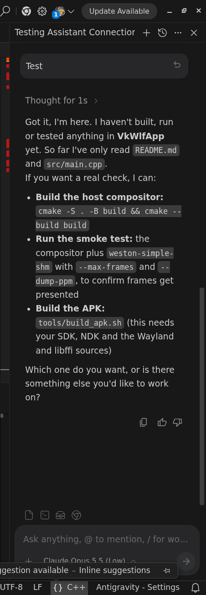

# VkWlfApp — Linux Wayland apps as first-class windows on Android desktop (experimental)

**Status: experimental / prototype. Not for production.**

VkWlfApp is an Android app that embeds a Wayland compositor and presents Linux
desktop apps (Antigravity, an Electron IDE, is the reference workload) as native Android windows:

- Wayland server (`wl_compositor`, `xdg-shell`, `linux-dmabuf`) in
  [`src/wayland_server_engine.cpp`](src/wayland_server_engine.cpp)
- Zero‑copy presentation: client dma‑bufs are imported as `AHardwareBuffer`s
  (`VK_ANDROID_external_memory_android_hardware_buffer`) in
  [`src/vk_renderer.cpp`](src/vk_renderer.cpp) — no shm uploads
- One Android window per toplevel, with the Linux app's own icon and title
  (dynamic `FabricatedOverlay`), input routing, focus
- A vsock/TCP "bridge" transport and an in‑guest proxy
  ([`src/vkwlf_guest_proxy.cpp`](src/vkwlf_guest_proxy.cpp)) for clients that
  run inside a VM

## Screenshots (Antigravity IDE on GoogleBook OS / Android Desktop)

Full **GoogleBook OS / Android Desktop** environment showing **VkWlfApp** presenting the **Antigravity IDE** (`2382×1299` Wayland surface) as a native freeform desktop window with custom app icon/title caption bar (`MainActivity.java`), alongside the Linux Terminal VM in the dock:



<details>
<summary><b>Raw Wayland Toplevel Surface & Right-side AI Agent Panel (Claude 5.5 / Gemini)</b></summary>
<br>





</details>

## Layout

| Path | What |
|---|---|
| `src/`, `include/` | compositor, Vulkan renderer, input, guest proxy |
| `java/`, `res/`, `assets/`, `AndroidManifest.xml` | the Android app (`com.google.example.vkwlf`) |
| `Android.bp`, `CMakeLists.txt` | Soong and CMake builds |
| `tools/build_apk.sh` | reproducible APK build (NDK + aapt2/d8/apksigner) |
| `guest/vkwlf-run` | in‑VM launcher: starts the proxy and runs a Wayland app against it |
| `guest/vkwlf-auto-bridge` | persistent auto-bridge service script for launching Antigravity IDE |
| `guest/vkwlf-cloudcode-proxy` | local Cloud Code model compatibility proxy for Antigravity IDE |
| `guest/` (rest) | dev‑rig only: host daemon, IDE chroot launcher, `libnopkey.c` shim |
| `tools/` (rest) | dev‑rig only: VM viewer launcher, VNC colour‑fix proxy, QEMU wrapper |
| `tests/` | `weston-simple-shm`, a minimal Wayland client used as the smoke test |

---

# Running on a real Android desktop device (release build)

On a release build the Linux app runs inside the stock **Terminal** VM and
VkWlfApp runs as a normal Android app. The two talk over TCP on the VM's virtual
network:

```
Terminal VM (Debian, KVM)                         Android (host)
  <wayland app> ──wayland──▶ vkwlf_guest_proxy ──TCP──▶ VkWlfApp ──AHardwareBuffer──▶ SurfaceFlinger
                             (guest/vkwlf-run)         bridge :5555
```

No root, no unlock, no flashing. Raster happens on the CPU inside the VM (the
Terminal VM's virtio‑gpu is 2D‑only); composition/presentation uses the host GPU.

## 1. Build and install VkWlfApp (on your workstation)

Requirements: Android SDK (`aapt2`, `d8`, `apksigner`, `zipalign`, `android.jar`),
an NDK, `cmake` ≥ 3.18, `wayland-scanner`, a JDK, and libwayland + libffi
*sources* (the NDK build compiles libwayland‑server from source). Point the variables below at your SDK, NDK and source checkouts.

```bash
# required
export ANDROID_SDK_ROOT=~/Android/Sdk
export ANDROID_NDK_ROOT=~/Android/Sdk/ndk/27.2.12479018
export VKWLF_WAYLAND_SRC=~/src/wayland          # git clone https://gitlab.freedesktop.org/wayland/wayland
export VKWLF_LIBFFI_SRC=~/src/libffi            # needs generated ffi.h for the target ABI

tools/build_apk.sh --abi x86_64                 # Intel Android desktop device; use arm64-v8a on Arm
adb install -r out/apk/VkWlfApp.apk             # or: tools/build_apk.sh --install <serial>
```

Start **VkWlfApp** once from the launcher. In `adb logcat` you should see:

```
VkWlfCompositor: Wayland display initialized; Unix socket bound at /data/user/<u>/com.google.example.vkwlf/cache/wayland-0
VkWlfCompositor: Bound TCP Wayland Bridge listener on 0.0.0.0:5555
```

> If the line says `0.0.0.0:5556`, port 5555 was busy (adbd takes it when
> wireless debugging is on). Use that port in step 3. `AF_VSOCK not available
> (Permission denied)` is expected for a normal app — TCP is the transport.

## 2. Build the guest side inside the Terminal VM

Open the Terminal app, then in the VM:

```bash
sudo apt update
sudo apt install -y git build-essential cmake pkg-config libwayland-bin \
    libwayland-dev wayland-protocols libvulkan-dev mesa-vulkan-drivers weston

git clone https://github.com/YungRaj/VlkWlfApp.git && cd VlkWlfApp
cmake -S . -B build -DCMAKE_BUILD_TYPE=Release
cmake --build build --target vkwlf_guest_proxy weston-simple-shm -j"$(nproc)"
sudo install -m755 build/vkwlf_guest_proxy guest/vkwlf-run /usr/local/bin/
```

(`wayland-scanner` is in `libwayland-bin` on Debian; `mesa-vulkan-drivers`
provides lavapipe so the proxy's Vulkan init has a device.)

## 3. Run a candidate Wayland app

`vkwlf-run` starts the proxy on a private `XDG_RUNTIME_DIR`, points it at the
host (default: the VM's default gateway, which is Android), and runs the app
with `WAYLAND_DISPLAY` set:

```bash
# smoke test — a 1600x900 test pattern should appear as its own Android window
vkwlf-run -- weston-simple-shm

# a real app
vkwlf-run -- weston-terminal
vkwlf-run -- foot                                   # apt install foot

# different bridge port (see note in step 1)
vkwlf-run --port 5556 -- weston-simple-shm
```

For **Antigravity** (a public Electron IDE) inside the VM —
install the Linux `.deb` from antigravity.google first, then:

```bash
vkwlf-run -- antigravity --ignore-gpu-blocklist ~/workspace
```

`vkwlf-run` already exports `ELECTRON_OZONE_PLATFORM_HINT=wayland`,
`GDK_BACKEND=wayland` and `QT_QPA_PLATFORM=wayland`, so Electron, GTK and Qt
apps pick the Wayland backend without extra flags. With `--ignore-gpu-blocklist`,
Chromium's GPU process allocates DRM PRIME `zwp_linux_dmabuf_v1` (`AB24`) buffers
via `/dev/dri/card0` & `/dev/dri/renderD128` (`zwp_linux_dmabuf_feedback_v1` v4)
and submits them zero-copy to `vkwlf_guest_proxy` (`shm_uploads=0`).

The window shows up on the Android desktop with the app's icon and title
(resolved from its `app_id` via the guest's `/usr/share/applications` +
`hicolor` icon theme — `antigravity.desktop` / `antigravity.png` from the `.deb`).

How the caption gets the right name/icon on a **release (user) build**: the
desktop window header is drawn by SystemUI from the *host package's* static
label/icon, and a normal app cannot change that at runtime (a self-targeting
`FabricatedOverlay` is only visible to the app itself). VkWlfApp therefore
requests a transparent caption-bar background — the system then stops drawing
the app name and keeps only its small launcher badge + app-menu chevron on the
left and the window controls on the right — and draws the Linux app's real icon
and name itself in the gap (bounds from `WindowInsets.getBoundingRects(captionBar())`).
The `TaskDescription` is also set so Recents shows the Linux app. If you ever
installed a static overlay (`com.google.example.vkwlf.overlay`) during
development, uninstall it; SystemUI caches the overlaid label until it restarts.

What has been verified end to end over the bridge with an Electron IDE
(Antigravity build): continuous frames (~60 fps at 2382×1299), zero-copy
`zwp_linux_dmabuf_v1` v4 client buffer commits (`fourcc=0x34324241`), Vulkan
external memory import (`VK_KHR_external_memory_fd` / `VK_EXT_external_memory_host`,
`shm_uploads=0`), window title/app_id/icon, keyboard input landing in the editor,
pointer clicks, and `xdg_popup` menus (File menu).

## 4. Enabling Full GPU Acceleration (`zwp_linux_dmabuf_v1` & `gfxstream_enabled=1`)

`VkWlfApp` and `vkwlf_guest_proxy` implement a 4-phase GPU & DMA-BUF pipeline:

1. **Phase 1 (Wayland Client GPU / GBM DMA-BUF)**: `WaylandServerEngine` advertises `zwp_linux_dmabuf_v1` **v4** (`zwp_linux_dmabuf_feedback_v1` with `/dev/dri/renderD128` + `DRM_FORMAT_MOD_LINEAR` + `DRM_FORMAT_MOD_INVALID`) so Wayland clients (including Antigravity IDE / Chromium Ozone Wayland) allocate DRM PRIME DMA-BUF buffers (`AB24` / `AR24`) instead of CPU `wl_shm` buffers.
2. **Phase 2 (Guest Vulkan DMA-BUF Compositor)**: `VkRenderer` inside `vkwlf_guest_proxy` and `vkwlf_compositor` imports client DMA-BUF file descriptors directly into Vulkan (`VK_KHR_external_memory_fd` and `VK_EXT_external_memory_host`, handling both tight and 64-pixel-aligned DRM row strides with `shm_uploads=0`).
3. **Phase 3 (VM-to-Host Bridge)**: `vkwlf_guest_proxy` streams `BufferType::kDmaBuf` frames over the bridge socket.
4. **Phase 4 (Android Host Hardware GPU Compositor)**: `VkWlfApp` imports each frame into a persistent hardware `AHardwareBuffer` (`VK_ANDROID_external_memory_android_hardware_buffer`, `shm_uploads=0`) and presents via `VkSwapchainKHR` on the host GPU.

### Enabling `gfxstream_enabled=1` by Default Inside the Debian Terminal VM

To configure the Debian Terminal VM so `gfxstream_enabled=1` is enabled by default in GRUB and all shell/systemd sessions prioritize `gfxstream_vk_icd.json` first (with automatic fallback to `lvp_icd.json` when the hypervisor launches `virtio-gpu` in 2D mode):

```bash
# 1. Add gfxstream_enabled=1 to the GRUB kernel command line
echo 'GRUB_CMDLINE_LINUX_DEFAULT="$GRUB_CMDLINE_LINUX_DEFAULT gfxstream_enabled=1 gfxstream_enabled"' \
  | sudo tee /etc/default/grub.d/99_gfxstream.cfg >/dev/null
sudo sed -i '/vmlinuz-/{/gfxstream_enabled/!s/$/ gfxstream_enabled=1 gfxstream_enabled/}' /boot/grub/grub.cfg

# 2. Configure /usr/local/bin/enable_gfxstream to prioritize gfxstream_vk_icd.json with lvp_icd.json fallback
sudo tee /usr/local/bin/enable_gfxstream >/dev/null <<'EOF'
#!/bin/bash
sudo systemd-run --quiet --collect -E XDG_SESSION_TYPE=wayland --uid=1000 -p PAMName=login -p TTYPath=/dev/tty1 sleep 1d 2>/dev/null || true
export DISPLAY=:0
if grep -q -w "wayland_bridge" /proc/cmdline; then
  export WAYLAND_DISPLAY=wayland-proxy-0
fi
export GFXSTREAM_ENABLED=1
if sudo -n dmesg 2>/dev/null | grep -q "number of cap sets: [1-9]"; then
  export MESA_LOADER_DRIVER_OVERRIDE=zink
else
  unset MESA_LOADER_DRIVER_OVERRIDE
fi
unset LIBGL_ALWAYS_SOFTWARE
export VK_ICD_FILENAMES=/usr/share/vulkan/icd.d/gfxstream_vk_icd.json:/usr/share/vulkan/icd.d/lvp_icd.json
export VK_DRIVER_FILES=/usr/share/vulkan/icd.d/gfxstream_vk_icd.json:/usr/share/vulkan/icd.d/lvp_icd.json
export MESA_VK_WSI_DEBUG=sw
export XWAYLAND_NO_GLAMOR=1
export LIBGL_KOPPER_DRI2=1
EOF
sudo chmod +x /usr/local/bin/enable_gfxstream

# 3. Enable /usr/local/bin/enable_gfxstream by default in /etc/profile.d/activate_display.sh
sudo tee /etc/profile.d/activate_display.sh >/dev/null <<'EOF'
#!/bin/bash
if [[ "$USER" == "droid" && -n "$PS1" ]]; then
  source /usr/local/bin/enable_gfxstream
fi
EOF

# 4. Install the updated proxy/compositor binaries and restart the auto-bridge service
sudo install -m 755 build/vkwlf_compositor build/vkwlf_guest_proxy guest/vkwlf-auto-bridge guest/vkwlf-run /usr/local/bin/
systemctl --user restart vkwlf-auto-bridge.service
```

### Enabling the Host Gfxstream 3D Ring on Android (`com.android.virtualization.terminal`)

For the guest's `/dev/dri/renderD128` PCI device (`0000:00:01.0`) to expose host Gfxstream capability sets (`+context_init`, `number of cap sets > 0`), the Android host's `VmLauncherService` must start Crosvm with the `gfxstream` GPU backend:

- **Via ADB on the Android host**:
  ```bash
  adb shell device_config put virtualization_framework_native terminal_gui_support true
  adb shell am force-stop com.android.virtualization.terminal
  ```
- **On `userdebug` / rooted Android builds (`vm_config.json`)**:
  Set the `"gpu"` block in the Terminal VM's `vm_config.json` and restart the Terminal app:
  ```json
  "params": "... gfxstream_enabled",
  "gpu": {
    "backend": "gfxstream",
    "vulkan": true,
    "surfaceless": true,
    "context-types": "gfxstream-vulkan:gfxstream-composer"
  }
  ```

### Verifying Zero-Copy DMA-BUF & Vulkan Composition

Check `/tmp/vkwlf-xdg-1000/proxy.log` inside the VM to confirm `shm_uploads=0` and `buffer_type=DMA-BUF`:

```bash
grep -E "Created zero-copy|GuestVulkanGPU" /tmp/vkwlf-xdg-1000/proxy.log
```

## 5. Troubleshooting

| Symptom | Cause / fix |
|---|---|
| `vkwlf-run: proxy exited: Failed to connect to host VkWlfCompositor` | VkWlfApp not running, wrong port, or the VM→host route is blocked. Check `ip route` in the VM for the gateway, `nc -vz <gateway> 5555`, and the logcat line from step 1. |
| Window appears but stays black | Client is using a buffer format the bridge doesn't forward; try `weston-simple-shm` first, then compare `logcat | grep VkWlfCompositor`. |
| Keys/mouse don't reach the app | Tap the window once to give it Android focus; check `logcat | grep InputHandler`. |
| `Bound TCP Wayland Bridge listener on 0.0.0.0:5556` | 5555 taken by adbd; pass `--port 5556`. |
| Slow scrolling / animation | Expected on this path (CPU raster + one copy per frame). GPU raster in the VM needs the Terminal VM's `gpu.backend` changed from `2d` (platform change) — see `docs/android_desktop_linux_apps_roadmap.md`. |

---

# Dev rig (how this snapshot was developed)

Development was done against a cuttlefish x86_64 desktop (Android desktop)
VM running under **QEMU TCG** (no KVM on the workstation), with the IDE in a
host‑side chroot (userdebug only). Several things in `guest/` and `tools/` exist
only to survive TCG and are **not needed on real hardware**:

- `libnopkey.so` (disables PKU, pins each Electron process to one vCPU)
- interpreter‑only V8 flags in `guest/run_linux_app.sh`
- `printk=0` in the daemon (virtio‑console traffic corrupts guest memory under MTTCG)
- the R/B‑swap VNC proxy (QEMU mislabels the virtio‑gpu scanout)

See `docs/` for the analysis and the roadmap:

- [`docs/tcg_crash_fix_walkthrough.md`](docs/tcg_crash_fix_walkthrough.md) — what broke under TCG and why
- [`docs/android_desktop_linux_apps_roadmap.md`](docs/android_desktop_linux_apps_roadmap.md) — phased plan to GPU raster / zero‑copy on release builds
- [`docs/wayland_direct_host_gpu_walkthrough.md`](docs/wayland_direct_host_gpu_walkthrough.md) — the direct‑on‑host GPU path (userdebug)
