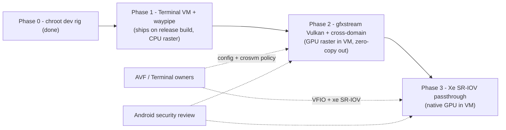

# Roadmap: Linux apps as first‑class windows on release Android desktop

Goal: launch a Linux desktop app (the IDE) from Android desktop and have it appear as a native Android window — correct icon/title, input, window management — rendered by the host GPU, on a **release (user) build**, with no root and no custom OS image on the device.

Non‑goal: productising the chroot‑on‑host prototype. It needs root and runs a glibc userland on the host kernel; it is the dev rig, not the product (see "Alternative" at the end).

## Dependency picture

Each phase is independently shippable; P2 and P3 only change *how fast* and *how* frames are produced. VkWlfApp (compositor, AHB import, window/icon integration) is the constant across all of them.

---

## Phase 0 — Prototype / dev rig (done)

| | |
|---|---|
| What exists | VkWlfApp Wayland compositor with zero‑copy `AHardwareBuffer` import, per‑app Android window + dynamic icon/label, input; the IDE running in a host chroot on a userdebug VM |
| Use going forward | Fast iteration on the compositor itself (no VM in the loop). **Do not** invest in making it shippable. |
| Cleanup | Strip TCG‑only workarounds (pkey shim, vCPU pinning, interpreter‑only V8, `printk=0`) behind a `TCG=1` switch so the scripts stay honest on real hardware |

## Phase 1 — Terminal VM + waypipe (shippable now)

**Outcome:** on a stock release Android desktop device, a user installs the IDE in the Terminal VM, runs a launcher, and gets a the IDE window on the Android desktop. CPU raster (llvmpipe), host GPU for composition.

| Workstream | Deliverable | Owner |
|---|---|---|
| VkWlfApp transport | Accept Wayland connections over a TCP/vsock‑forwarded socket (waypipe client side), in addition to the Unix socket | us |
| Guest launcher | `vkwlf-run` script in the VM: `waypipe --compress lz4 -s … server example-ide …`, plus port setup via Terminal's port forwarding | us |
| Window identity | Map `app_id`/title/icon from the remote client (already done for local clients); handle multiple windows/apps per connection | us |
| Input/clipboard/DPI | Verify keyboard layouts, pointer/scroll, clipboard via waypipe, HiDPI scale factor | us |
| Packaging | VkWlfApp as a normal Play‑installable app; guest side as a `.deb` or one‑line installer | us |
| Measurement | Workbench load, keystroke‑to‑paint, scroll fps, TS server latency vs. chroot numbers on the same device | us |

Exit criteria: the IDE usable for a full working session on a release build; perf within ~10 % of the chroot on CPU‑bound metrics; documented gap on scroll/animation smoothness (expected, Phase 2 fixes it).

Dependencies: an Intel Android desktop device with the stock Terminal app. Nothing from other teams.

Timeline: ~1–2 weeks.

## Phase 2 — GPU raster in the VM + zero‑copy out (platform change)

**Outcome:** Chromium rasterises on the Intel iGPU from inside the VM; frames reach VkWlfApp without a copy.

| Workstream | Deliverable | Owner |
|---|---|---|
| Terminal VM config | `vm_config.json`: `gpu.backend=gfxstream` (or `virglrenderer` + Venus), `vulkan=true`, `context-types=…:cross-domain` — the plumbing already exists in `VirtualMachineCustomImageConfig.GpuConfig` / `virtmgr` | **AVF / Terminal owners** (we provide the ask + demo) |
| Guest drivers | Mesa gfxstream (or Venus) Vulkan ICD in the Debian image; Chromium flags `--use-angle=vulkan --enable-features=Vulkan,VulkanFromANGLE`, drop `--disable-gpu` | us (guest packaging) + AVF (image) |
| Guest Wayland proxy | sommelier‑style proxy exporting buffers as virtio‑gpu blob resources over cross‑domain | us, reusing ChromeOS sommelier |
| Host import | VkWlfApp accepts blob‑backed dma‑bufs via `linux-dmabuf` with Intel modifiers (`Y_TILED`, CCS) or negotiates `LINEAR` | us |
| Security | Review of gfxstream/cross‑domain exposure in the Terminal VM (host Vulkan driver surface) | AVF + Android security |

Exit criteria: `chrome://gpu` reports hardware raster/compositing inside the VM; no per‑frame copy on the host (`shm_uploads=0`, blob imports); 60 fps scrolling in the editor.

Dependencies: Phase 1 (gives the demo and the measurements that justify the ask); AVF/Terminal buy‑in for the config change.

Timeline: our side ~3–4 weeks once the config is available; calendar time dominated by the platform change + review.

## Phase 3 — Intel Xe SR‑IOV GPU passthrough (native)

**Outcome:** the VM gets a GPU virtual function; stock Mesa ANV/Iris run natively in the guest. Frames still exit via the Phase‑2 zero‑copy path (VFs have no display).

| Workstream | Deliverable | Owner |
|---|---|---|
| Kernel | `xe` PF with SR‑IOV enabled on the Android desktop device kernel (6.12 is in range); VF count + LMEM/GGTT sizing | **AVF / kernel** |
| VMM | crosvm VFIO passthrough of the VF into the Terminal VM; AVF policy | **AVF** |
| Guest | Replace gfxstream ICD with stock Mesa; nothing else changes | us |
| Host | No change — same dma‑buf/AHB import | — |
| Security | Shared GuC scheduler/firmware as trusted surface; IOMMU isolation review | AVF + security |

Exit criteria: native‑class raster inside the VM; Phase‑2 zero‑copy path unchanged.

Dependencies: Gen12+ iGPU with SR‑IOV exposed in firmware; AVF roadmap. Entirely upstream of us — we are a consumer, not a blocker.

---

## Risks and what retires them

| Risk | Phase | Mitigation |
|---|---|---|
| Phase 1 feels too slow to be worth shipping | 1 | Measure first; IDE workloads are CPU‑bound and KVM is near‑native — the chroot numbers we have are the baseline |
| AVF declines gfxstream/cross‑domain in the Terminal VM | 2 | Phase 1 still ships; Phase 3 becomes the GPU path, with cross‑domain replaced by virtio‑gpu scanout + copy if needed |
| Intel modifier mismatch between Mesa (guest) and gralloc/AHB (host) | 2 | Negotiate `LINEAR` first, enable tiled/CCS formats behind a flag once verified |
| `CONFIG_USER_NS` off in the guest kernel → Chromium sandbox | 1–3 | Guest kernel is AVF's Debian kernel (has it); not the Android kernel |
| Review scope creep | 2–3 | VkWlfApp stays an unprivileged app throughout; all privileged pieces live in AVF/Terminal where they are already reviewed |

## Alternative considered: ship the chroot as a platform feature

Technically possible (daemon in its own SELinux domain, verity rootfs, Linux apps as an unprivileged UID, Mesa on `renderD128`) and it is "Phase 3 performance for free". Rejected as the primary path because it puts a glibc userland on the host kernel with no VM boundary — the review burden lands on us and the precedent (crouton → Crostini, ARC++ → ARCVM) is that it does not survive long‑term. Keep as a documented fallback only.

## Immediate next steps

1. Flash a userdebug build on the Intel Android desktop device for development (release build for validation).
2. Start Phase 1: waypipe/TCP transport in VkWlfApp + guest launcher; measure against the chroot.
3. Write the Phase‑2 ask for the AVF/Terminal owners with the Phase‑1 demo and numbers attached.
